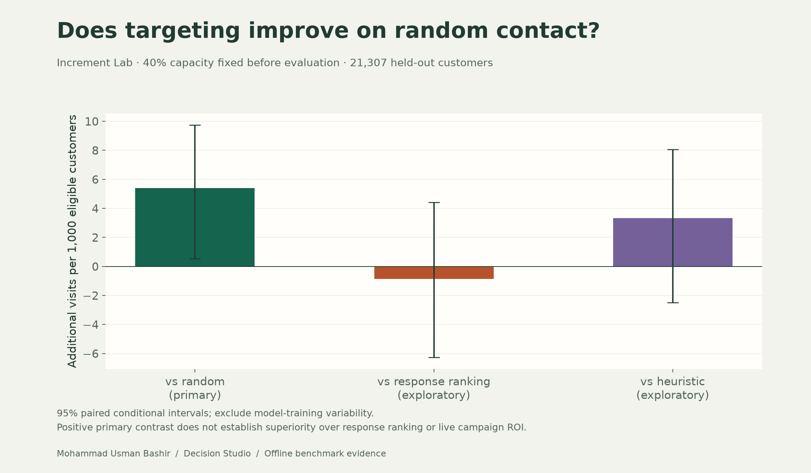

# Increment Lab
## Marketing uplift and email targeting

I built Increment Lab to evaluate whether uplift modelling could improve email targeting when only 40% of eligible customers can be contacted. I used the public Hillstrom randomised experiment and separated policy training from evaluation.

The preset targeting policy estimated **5.39 additional visits per 1,000 eligible customers compared with expected random contact at the same capacity**. Its conditional 95% interval was **0.54 to 9.73**, using 21,307 held-out customers. This is an offline estimate, not a measured new campaign result.



## Results and interpretation

| Comparison at 40% contact capacity | Additional visits per 1,000 eligible customers | Conditional 95% interval |
| --- | ---: | --- |
| Expected random contact, primary | 5.39 | 0.54 to 9.73 |
| Response ranking, exploratory | -0.87 | -6.26 to 4.40 |
| Rule based heuristic, exploratory | 3.32 | -2.48 to 8.07 |

Response ranking was slightly higher on the point estimate. I could not establish an advantage over that baseline. These intervals condition on fitted models, exclude training variability and are not evidence of live campaign ROI.

## My approach

1. Audit the source checksum, schema, missing values, assignment counts and feature balance. Preserve repeated feature rows where customer identities cannot be established.
2. Retain the Mens E-Mail and No E-Mail campaign arms. Use seven attributes recorded before contact and exclude assignment and outcomes from targeting features.
3. Fix the visit outcome, T-logistic primary learner and illustrative 40% contact capacity before fitting. Split into 21,306 training rows and 21,307 evaluation rows, stratified by assignment.
4. Train separate logistic regression models for treated and control customers. Rank eligible customers by the difference in predicted visit probability.
5. Evaluate policy value with augmented inverse probability weighting and known randomisation probability 0.5. Compare against expected random contact at the same selected count.
6. Quantify uncertainty with 2,000 paired, arm-stratified bootstrap resamples, reapplying the capacity rule to fixed scores. Keep secondary learners and comparisons exploratory.

## Run locally

Python 3.11 or later. The package declares the pinned dependency versions used by the project.

```sh
python3.11 -m venv .venv
source .venv/bin/activate
python -m pip install -e . pytest==9.2.0
python -m pytest tests -q
python run.py download
python run.py reproduce --tag verification
```

On Windows, activate with `.venv\Scripts\activate`. Reproduction writes to a new directory beneath `reproductions/` and compares the saved policy results using floating point tolerances. It refuses an existing output directory and preserves the original evidence. Training and 2,000 resamples take longer than unit tests.

## Data and evidence

- [Dataset source, download instructions and checksum](data/README.md)
- [Prespecified analysis plan](analysis_plan.json) and [superseded pre-fit plan](analysis_plan_v1_superseded.json)
- [Saved results](reports/evaluation/results.json) and [policy table](reports/evaluation/policy_results.csv)
- [Data audit](reports/evaluation/data_audit.json) and [original plan and code hashes](reports/evaluation/plan_lock.json)
- [Source code](src/uplift_lab) and [tests](tests/test_policy.py)
- [Packaging validation](VALIDATION.md)

The raw dataset remains available from its source through a checksum-verified downloader. I have not asserted redistribution rights over third-party data. No credentials, local environment files or fitted model binaries are included.

## Limits and next steps

This is a historical 2008 experiment. Individual counterfactual effects are unobserved. The contact capacity is illustrative, not an optimised commercial budget. Costs and margins are unavailable, so I make no profit claim. I would next test retraining sensitivity and evaluate a prespecified policy in a new campaign with measured costs and margins.

## Skills demonstrated

Python, data auditing, logistic regression, causal inference, policy evaluation, bootstrap uncertainty, reproducible analysis and marketing analytics.
